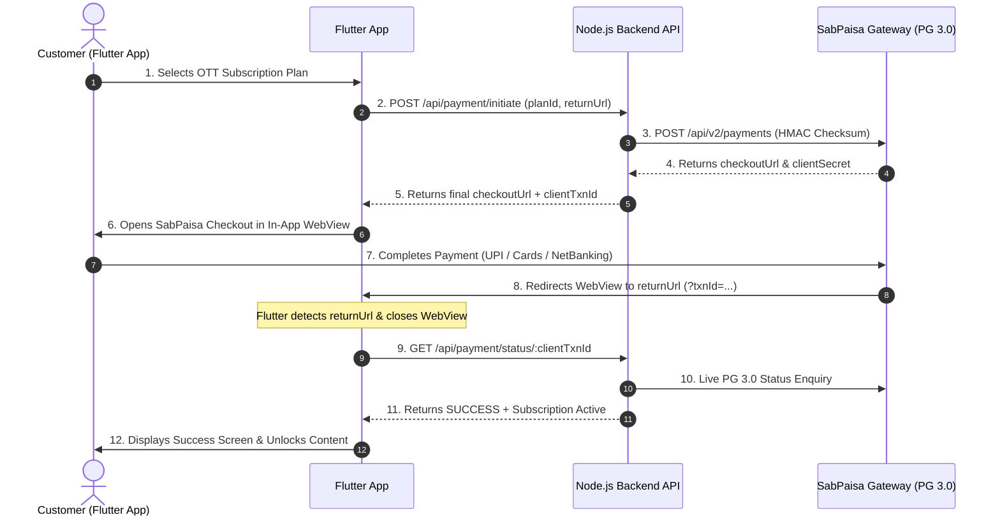

# 📱 Masti Adda OTT - Flutter SabPaisa PG 3.0 Integration Guide

This guide provides end-to-end instructions, architecture diagrams, complete API contracts, and copy-paste ready Flutter (Dart) code for integrating **SabPaisa Payment Gateway (PG 3.0)** into the Masti Adda OTT Flutter application.

---

## 📑 Table of Contents
1. [Architecture & Payment Flow](#1-architecture--payment-flow)
2. [API Endpoints Reference](#2-api-endpoints-reference)
3. [Flutter Setup & Dependencies](#3-flutter-setup--dependencies)
4. [Step-by-Step Flutter Implementation](#4-step-by-step-flutter-implementation)
   - [A. Data Models](#a-data-models)
   - [B. Payment API Service](#b-payment-api-service)
   - [C. SabPaisa WebView Screen](#c-sabpaisa-webview-screen)
   - [D. Integration in Subscription / Checkout Screen](#d-integration-in-subscription--checkout-screen)
5. [Testing & Staging Flow](#5-testing--staging-flow)
6. [Best Practices & Error Handling](#6-best-practices--error-handling)

---

## 1. Architecture & Payment Flow



### Key Security Rule:
> **Never verify payment exclusively on the client.** Once the WebView encounters the return URL, the Flutter app must **always** call the backend status endpoint (`GET /api/payment/status/:clientTxnId`) to let the backend cryptographically verify the transaction with SabPaisa and activate the subscription in MongoDB.

---

## 2. API Endpoints Reference

### Base URL
> ⚠️ **CRITICAL NOTE FOR DEVELOPER**: 
> * **DO NOT USE** `https://mastiadda.in` as Base URL! That domain serves the **Frontend Website (HTML)**, and calls to it will return `<!DOCTYPE html>` instead of JSON.
> * **ALWAYS USE** `https://api.mastiadda.in` for the Backend API!

* **Live Production/Staging API**: `https://api.mastiadda.in/api`
* **Local Machine / Development**: 
  * Android Emulator: `http://10.0.2.2:5000/api`
  * Physical Device (Same Wi-Fi): `http://<YOUR_PC_IP>:5000/api`
  * iOS Simulator: `http://localhost:5000/api`

---

### Endpoint 1: Fetch Available Plans
* **Method**: `GET`
* **Route**: `/api/plan`
* **Auth**: Optional / None
* **Sample Response (200 OK)**:
```json
{
  "success": true,
  "count": 2,
  "plans": [
    {
      "_id": "6ac9cc1455c581153f22d56e",
      "name": "Premium Plan",
      "price": 199,
      "duration": 30,
      "planType": "monthly",
      "description": "Access to all Movies, Series & Audio Stories"
    }
  ]
}
```

---

### Endpoint 2: Initiate Payment Session
* **Method**: `POST`
* **Route**: `/api/payment/initiate`
* **Headers**:
  ```http
  Authorization: Bearer <USER_JWT_TOKEN>
  Content-Type: application/json
  ```
* **Request Body**:
```json
{
  "planId": "6ac9cc1455c581153f22d56e",
  "promoCode": "DISCOUNT50", 
  "returnUrl": "https://mastiadda.in/payment-callback"
}
```
> **Note on `returnUrl`**: You can pass any unique callback URL (e.g., `https://mastiadda.in/payment-callback`). The Flutter WebView will watch for this URL to know when payment has finished.

* **Sample Response (200 OK)**:
```json
{
  "success": true,
  "paymentUrl": "https://staging-sb-checkout.sabpaisa.in/checkout/sppay_abc123?clientSecret=sppay_abc123_secret_xyz",
  "checkoutUrl": "https://staging-sb-checkout.sabpaisa.in/checkout/sppay_abc123?clientSecret=sppay_abc123_secret_xyz",
  "paymentId": "sppay_abc123",
  "clientTxnId": "TXN_1729000000000_A1B2C3",
  "finalAmount": 199,
  "returnUrl": "https://mastiadda.in/payment-callback?txnId=TXN_1729000000000_A1B2C3",
  "plan": {
    "id": "6ac9cc1455c581153f22d56e",
    "name": "Premium Plan",
    "duration": 30,
    "price": 199
  }
}
```

---

### Endpoint 3: Check / Verify Transaction Status
* **Method**: `GET`
* **Route**: `/api/payment/status/:clientTxnId`
* **Headers**:
  ```http
  Authorization: Bearer <USER_JWT_TOKEN>
  ```
* **Sample Response (Success - 200 OK)**:
```json
{
  "success": true,
  "status": "SUCCESS",
  "statusCode": "0000",
  "message": "Payment verified and subscription activated successfully",
  "subscription": {
    "_id": "6ad1123456789abcdef",
    "user": "6ac8cf138663bf5419b1ceab",
    "plan": "6ac9cc1455c581153f22d56e",
    "status": "active",
    "startDate": "2026-10-29T12:00:00.000Z",
    "endDate": "2026-11-28T12:00:00.000Z",
    "amount": 199
  }
}
```
* **Sample Response (Pending / Failed - 200 OK)**:
```json
{
  "success": false,
  "status": "FAILED",
  "statusCode": "0300",
  "message": "Payment failed or was cancelled by user"
}
```

---

## 3. Flutter Setup & Dependencies

Add the official WebView package and HTTP client in your `pubspec.yaml`:

```yaml
dependencies:
  flutter:
    sdk: flutter
  http: ^1.2.0              # Or dio: ^5.4.0
  webview_flutter: ^4.7.0   # Official Flutter WebView
```

### Android Permissions & Cleartext Traffic
Ensure your `android/app/src/main/AndroidManifest.xml` has Internet access:
```xml
<manifest xmlns:android="http://schemas.android.com/apk/res/android">
    <uses-permission android:name="android.permission.INTERNET"/>
    
    <application
        android:label="Masti Adda"
        android:usesCleartextTraffic="true"
        ...>
    </application>
</manifest>
```

### iOS Configuration
In `ios/Runner/Info.plist`, allow arbitrary loads if testing local HTTP endpoints:
```xml
<key>NSAppTransportSecurity</key>
<dict>
    <key>NSAllowsArbitraryLoads</key>
    <true/>
</dict>
```

---

## 4. Step-by-Step Flutter Implementation

### A. Data Models
Create `lib/models/payment_models.dart`:

```dart
class InitiatePaymentResponse {
  final bool success;
  final String checkoutUrl;
  final String clientTxnId;
  final num finalAmount;
  final String? message;

  InitiatePaymentResponse({
    required this.success,
    required this.checkoutUrl,
    required this.clientTxnId,
    required this.finalAmount,
    this.message,
  });

  factory InitiatePaymentResponse.fromJson(Map<String, dynamic> json) {
    return InitiatePaymentResponse(
      success: json['success'] ?? false,
      checkoutUrl: json['checkoutUrl'] ?? json['paymentUrl'] ?? '',
      clientTxnId: json['clientTxnId'] ?? '',
      finalAmount: json['finalAmount'] ?? 0,
      message: json['message'],
    );
  }
}

class PaymentStatusResponse {
  final bool success;
  final String status;
  final String? statusCode;
  final String message;
  final Map<String, dynamic>? subscription;

  PaymentStatusResponse({
    required this.success,
    required this.status,
    this.statusCode,
    required this.message,
    this.subscription,
  });

  factory PaymentStatusResponse.fromJson(Map<String, dynamic> json) {
    return PaymentStatusResponse(
      success: json['success'] ?? false,
      status: json['status'] ?? 'PENDING',
      statusCode: json['statusCode'],
      message: json['message'] ?? '',
      subscription: json['subscription'],
    );
  }
}
```

---

### B. Payment API Service
Create `lib/services/payment_service.dart`:

```dart
import 'dart:convert';
import 'package:http/http.dart' as http;
import '../models/payment_models.dart';

class PaymentService {
  // Use https://api.mastiadda.in/api for live server (NOT https://mastiadda.in)
  static const String baseUrl = 'https://api.mastiadda.in/api'; 
  // For local testing: 'http://10.0.2.2:5000/api' (Android Emulator) or 'http://localhost:5000/api' (iOS)
  
  static const String customReturnUrl = 'https://mastiadda.in/payment-callback';

  /// 1. Initiate SabPaisa Payment Session
  static async Future<InitiatePaymentResponse> initiatePayment({
    required String token,
    required String planId,
    String? promoCode,
  }) async {
    final url = Uri.parse('$baseUrl/payment/initiate');
    
    final response = await http.post(
      url,
      headers: {
        'Content-Type': 'application/json',
        'Authorization': 'Bearer $token',
      },
      body: jsonEncode({
        'planId': planId,
        'promoCode': promoCode,
        'returnUrl': customReturnUrl,
      }),
    );

    final data = jsonDecode(response.body);
    if (response.statusCode == 200 && data['success'] == true) {
      return InitiatePaymentResponse.fromJson(data);
    } else {
      throw Exception(data['message'] ?? 'Failed to initiate payment session');
    }
  }

  /// 2. Verify Payment Status & Activate Subscription
  static async Future<PaymentStatusResponse> checkPaymentStatus({
    required String token,
    required String clientTxnId,
  }) async {
    final url = Uri.parse('$baseUrl/payment/status/$clientTxnId');

    final response = await http.get(
      url,
      headers: {
        'Authorization': 'Bearer $token',
      },
    );

    final data = jsonDecode(response.body);
    return PaymentStatusResponse.fromJson(data);
  }
}
```

---

### C. SabPaisa WebView Screen
Create `lib/screens/sabpaisa_webview_screen.dart`:

This screen opens the SabPaisa checkout URL, monitors navigation, intercepts the return URL callback, and returns the transaction ID back to the caller screen.

```dart
import 'package:flutter/material.dart';
import 'package:webview_flutter/webview_flutter.dart';

class SabPaisaWebViewScreen extends StatefulWidget {
  final String checkoutUrl;
  final String clientTxnId;
  final String returnUrlPrefix;

  const SabPaisaWebViewScreen({
    Key? key,
    required this.checkoutUrl,
    required this.clientTxnId,
    this.returnUrlPrefix = 'mastiadda.in/payment-callback',
  }) : super(key: key);

  @override
  State<SabPaisaWebViewScreen> createState() => _SabPaisaWebViewScreenState();
}

class _SabPaisaWebViewScreenState extends State<SabPaisaWebViewScreen> {
  late final WebViewController _controller;
  bool _isLoading = true;
  bool _hasIntercepted = false;

  @override
  void initState() {
    super.initState();

    _controller = WebViewController()
      ..setJavaScriptMode(JavaScriptMode.unrestricted)
      ..setBackgroundColor(const Color(0xFF0F172A))
      ..setNavigationDelegate(
        NavigationDelegate(
          onPageStarted: (String url) {
            setState(() => _isLoading = true);
            _checkUrlForCompletion(url);
          },
          onPageFinished: (String url) {
            setState(() => _isLoading = false);
            _checkUrlForCompletion(url);
          },
          onNavigationRequest: (NavigationRequest request) {
            if (_checkUrlForCompletion(request.url)) {
              return NavigationDecision.prevent;
            }
            return NavigationDecision.navigate;
          },
        ),
      )
      ..loadRequest(Uri.parse(widget.checkoutUrl));
  }

  bool _checkUrlForCompletion(String url) {
    if (_hasIntercepted) return true;

    // Check if the gateway has redirected back to the app's returnUrl
    if (url.contains(widget.returnUrlPrefix) || url.contains('txnId=')) {
      _hasIntercepted = true;
      // Close WebView and pass back clientTxnId for server verification
      Navigator.of(context).pop(widget.clientTxnId);
      return true;
    }
    return false;
  }

  @override
  Widget build(BuildContext context) {
    return WillPopScope(
      onWillPop: () async {
        final confirmCancel = await showDialog<bool>(
          context: context,
          builder: (ctx) => AlertDialog(
            backgroundColor: const Color(0xFF1E293B),
            title: const Text('Cancel Payment?', style: TextStyle(color: Colors.white)),
            content: const Text(
              'Are you sure you want to cancel? Any in-progress transaction will be aborted.',
              style: TextStyle(color: Color(0xFF94A3B8)),
            ),
            actions: [
              TextButton(
                onPressed: () => Navigator.pop(ctx, false),
                child: const Text('Continue Payment'),
              ),
              TextButton(
                onPressed: () => Navigator.pop(ctx, true),
                child: const Text('Cancel', style: TextStyle(color: Colors.redAccent)),
              ),
            ],
          ),
        );
        return confirmCancel ?? false;
      },
      child: Scaffold(
        backgroundColor: const Color(0xFF0B0F19),
        appBar: AppBar(
          title: const Text('SabPaisa Secure Checkout', style: TextStyle(fontSize: 16)),
          backgroundColor: const Color(0xFF0F172A),
          elevation: 0,
          leading: IconButton(
            icon: const Icon(Icons.close),
            onPressed: () => Navigator.of(context).pop(null),
          ),
        ),
        body: Stack(
          children: [
            WebViewWidget(controller: _controller),
            if (_isLoading)
              const Center(
                child: CircularProgressIndicator(
                  color: Color(0xFFFFD11A), // Masti Adda Brand Gold
                ),
              ),
          ],
        ),
      ),
    );
  }
}
```

---

### D. Integration in Subscription / Checkout Screen
Here is how to call the flow when a user taps **"Subscribe Now"**:

```dart
void handleSubscribe(BuildContext context, String planId, String userToken) async {
  // 1. Show Loading Indicator
  showDialog(
    context: context,
    barrierDismissible: false,
    builder: (_) => const Center(
      child: CircularProgressIndicator(color: Color(0xFFFFD11A)),
    ),
  );

  try {
    // 2. Call Backend Initiate Endpoint
    final initiateResult = await PaymentService.initiatePayment(
      token: userToken,
      planId: planId,
    );

    // Close loading dialog
    Navigator.of(context).pop();

    if (!initiateResult.success || initiateResult.checkoutUrl.isEmpty) {
      ScaffoldMessenger.of(context).showSnackBar(
        const SnackBar(content: Text('Failed to launch payment gateway')),
      );
      return;
    }

    // 3. Open SabPaisa In-App WebView
    final txnId = await Navigator.push<String?>(
      context,
      MaterialPageRoute(
        builder: (_) => SabPaisaWebViewScreen(
          checkoutUrl: initiateResult.checkoutUrl,
          clientTxnId: initiateResult.clientTxnId,
        ),
      ),
    );

    // If user cancelled manually
    if (txnId == null) {
      ScaffoldMessenger.of(context).showSnackBar(
        const SnackBar(content: Text('Payment cancelled by user')),
      );
      return;
    }

    // 4. Verify Payment with Backend API
    showDialog(
      context: context,
      barrierDismissible: false,
      builder: (_) => const Center(
        child: Column(
          mainAxisSize: MainAxisSize.min,
          children: [
            CircularProgressIndicator(color: Color(0xFFFFD11A)),
            SizedBox(height: 16),
            Text(
              'Verifying payment with bank...',
              style: TextStyle(color: Colors.white, fontSize: 14),
            )
          ],
        ),
      ),
    );

    final statusResult = await PaymentService.checkPaymentStatus(
      token: userToken,
      clientTxnId: txnId,
    );

    // Close verification dialog
    Navigator.of(context).pop();

    // 5. Handle Final Status
    if (statusResult.success && statusResult.status == 'SUCCESS') {
      showDialog(
        context: context,
        builder: (ctx) => AlertDialog(
          backgroundColor: const Color(0xFF1E293B),
          title: const Text('🎉 Subscription Activated!', style: TextStyle(color: Colors.greenAccent)),
          content: Text(
            'Your payment of ₹${initiateResult.finalAmount} was successful.\nEnjoy unlimited streaming on Masti Adda!',
            style: const TextStyle(color: Colors.white70),
          ),
          actions: [
            ElevatedButton(
              style: ElevatedButton.styleFrom(backgroundColor: const Color(0xFFFFD11A)),
              onPressed: () {
                Navigator.pop(ctx);
                // Refresh user state or navigate to Home
              },
              child: const Text('Start Watching', style: TextStyle(color: Colors.black, fontWeight: FontWeight.bold)),
            ),
          ],
        ),
      );
    } else {
      ScaffoldMessenger.of(context).showSnackBar(
        SnackBar(
          content: Text(statusResult.message.isNotEmpty ? statusResult.message : 'Payment was not successful. Please try again.'),
          backgroundColor: Colors.redAccent,
        ),
      );
    }
  } catch (err) {
    Navigator.of(context).pop(); // Ensure loader is dismissed
    ScaffoldMessenger.of(context).showSnackBar(
      SnackBar(content: Text('Error: ${err.toString()}')),
    );
  }
}
```

---

## 5. Testing & Staging Flow

### A. Development Login (No Real SMS Needed)
You can authenticate any test user instantly in development:
* **Phone Number**: `+919999999999`
* **OTP**: `1234`
* Call `POST /api/auth/send-otp` followed by `POST /api/auth/verify-otp` to receive your test user JWT token.

### B. SabPaisa Staging Gateway Simulator
When the SabPaisa checkout page loads in the WebView:
1. Select **NetBanking / Simulator** or **UPI / QR**.
2. Select **Success** or **Failure** simulation in the staging dropdown.
3. Upon clicking Submit, SabPaisa redirects to `returnUrl?txnId=...`.
4. Your Flutter WebView intercepts the URL, closes, and verifies the active subscription status.

---

## 6. Best Practices & Error Handling

1. **Android Back Button (WillPopScope / PopScope)**:
   Always prompt confirmation before letting the user press back during an active transaction session.
2. **Network Interruption Resilience**:
   If the user's phone turns off or loses internet inside the gateway, SabPaisa automatically fires a server-to-server **Webhook** (`POST /api/payment/webhook`). When the user reopens the Flutter app, simply calling `GET /api/subscription` or `GET /api/payment/status/:clientTxnId` will accurately reflect the activated subscription.
3. **Dynamic Deep-Linking**:
   If you prefer deep-linking instead of web URL interception, pass `returnUrl: "mastiadda://payment-callback"` in the initiate request body.

---

Happy Coding! 🚀  
For any backend questions, reach out to the backend engineering team.

